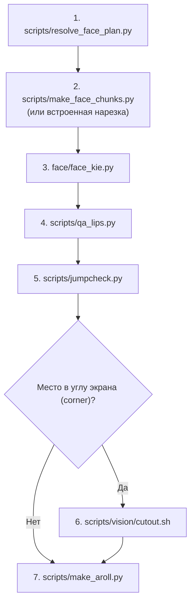

# Модуль `face/`: генерация говорящего лица через kie.ai

Модуль отвечает за создание видео говорящего автора по разметке таймлайна (`plan.json`), аудиозаписи речи (`voice.wav`) и эталонной фотографии портрета (`portrait.jpg`).

Провайдер — единый API [kie.ai](https://kie.ai), заменяющий закрытые локальные генераторы на публичный облачный сервис.

---

## 1. Подготовка эталонного портрета (`portrait.jpg`)

Качество входного фото определяет реалистичность и стабильность видео:

- **Ракурс**: строго анфас, взгляд направлен прямо в объектив камеры. Профиль, полуоборот или наклон головы приводят к искажениям геометрии при поворотах.
- **Освещение**: мягкий, равномерный студийный свет без глубоких теней на лице и пересветов.
- **Мимика**: нейтральное, спокойное выражение лица, рот закрыт. Сильные эмоции (широкая улыбка, смех, прищур) зафиксируются моделью как базовое состояние и испортят синхронизацию губ.
- **Детали**: без очков (блики на линзах ломают генерацию глаз), без головных уборов, чёлка не должна закрывать брови и глаза.
- **Кадрирование**: плечи и верхняя часть торса в кадре (нагрудный или поясной план), лицо занимает около 40–50% высоты кадра.
- **Технические параметры**: формат JPEG, PNG или WEBP; размер файла до 10 МБ; разрешение от 1024×1024 (квадрат 1:1) или 1080×1920 (вертикальное 9:16).
- **Размещение**: сохраните фото в `work/refs/portrait.jpg` (или укажите путь через `--photo`).

---

## 2. Модели и выбор разрешения

В CLI `face_kie.py` доступны три семейства моделей kie.ai (флаг `--model`):

| Модель в CLI | Имя в API kie.ai | Разрешение | Назначение и рекомендации |
|---|---|---|---|
| `kling-avatar` (по умолчанию) | `kling/ai-avatar-standard` | 720p | **Основной выбор для уроков**: быстрый рендер, естественные кивки и стабильный липсинк. |
| `kling-avatar` с `--quality pro` | `kling/ai-avatar-pro` | 1080p | Высокая чёткость (Full HD) для вступительных хуков, презентаций и важных фрагментов. |
| `infinitalk` | `infinitalk/from-audio` | 480p или 720p (`--resolution`) | MeiGen InfiniTalk: точный липсинк для длинных связных монологов до 15 с. |
| `omnihuman-1.5` | `omnihuman-1-5` | 720 или 1080 (`--resolution`) | ByteDance OmniHuman 1.5: выразительная мимика и реалистичная динамика портрета. |

### Ограничение по длительности аудио
- **Строгий лимит: не более 15 секунд на одно место.**
- Модели аватаров kie.ai ориентированы на аудиофрагменты до 15 секунд. Если реплика в сценарии длится дольше, скрипт завершится с ошибкой и подсказкой: необходимо разбить реплику на два места в `face_plan.json`.

### Правило промпта
- **В промпт никогда не вставляется текст реплики.** Текст реплики заставляет модель пытаться произносить свои слова или дублировать текст субтитрами на экране.
- Промпт по умолчанию описывает только нейтральную студийную обстановку и мимику:
  > *"A person talking directly to the camera in a calm studio, natural facial expressions, slight nods, lips in sync with the audio, no text or captions"*

---

## 3. Таблица стоимости

Списание кредитов происходит на стороне kie.ai по тарифам конкретных моделей.

| Модель | Режим | Списание кредитов | Примечание |
|---|---|---|---|
| `kling/ai-avatar-standard` | 720p | См. цены на docs.kie.ai | Тарифицируется за секунду сгенерированного видео (~$0.04/с ориентировочно) |
| `kling/ai-avatar-pro` | 1080p | См. цены на docs.kie.ai | Тарифицируется за секунду сгенерированного видео (~$0.08/с ориентировочно) |
| `infinitalk/from-audio` | 480p / 720p | См. цены на docs.kie.ai | Тарифицируется за генерацию (480p дешевле, 720p компромисс) |
| `omnihuman-1-5` | 720 / 1080 | См. цены на docs.kie.ai | См. актуальные тарифы на docs.kie.ai |

> [!NOTE]
> Загрузка файлов (фото и нарезанных mp3) в хранилище kie.ai бесплатна. Файлы хранятся от 24 часов до 3 дней.
> Баланс кредитов проверяется запросом `GET https://api.kie.ai/api/v1/chat/credit` или в кабинете [kie.ai/api-key](https://kie.ai/api-key).

---

## 4. Пошаговый порядок конвейера в проекте

Генерация лица — слой 5 общего производственного цикла видеоурока:



1. **`scripts/resolve_face_plan.py`**: сопоставляет разметку `face_plan.json` с таймлайном синтезированного голоса `timeline.json` и формирует `plan.json` (интервалы `display`, `gen`, тишина `pad: 0.4`, общая длина `dur` 8–12 с).
2. **`scripts/make_face_chunks.py`** (или встроенная нарезка в `face_kie.py`): готовит аудиодорожки `<id>.mp3` с тишиной 0.4 с в начале и в конце для каждого места лица.
3. **`face/face_kie.py`**: загружает портрет и аудио в kie.ai, отправляет задачи `createTask`, опрашивает `recordInfo` и скачивает `<id>.mp4` в папку вывода.
4. **`scripts/qa_lips.py`**: проверяет соответствие аудиодорожки видеоролика исходной речи (корреляция формы волны ≥ 0.7) и создаёт контактный лист кадров с шагом 0.5 с.
5. **`scripts/jumpcheck.py`**: анализирует видео детектором YuNet на скачки размера и положения лица (> 18 % между соседними кадрами). Брак перегенерируется точечно.
6. **`scripts/vision/cutout.sh`** (только для мест с показом лица в углу `corner` / `full→corner`): вырезает фон с помощью PP-HumanSeg и guided filter, создавая `_cutout.webm` с альфа-каналом.
7. **`scripts/make_aroll.py`**: упаковывает готовые ролики и переходы в `aroll.json` для Remotion.

---

## 5. Использование `face_kie.py`

### Установка зависимостей
```bash
pip install -r requirements.txt
```
Требуются установленные системные утилиты `ffmpeg` и `ffprobe`.

### Переменные окружения
Добавьте ключ в файл `.env` (в корне проекта) или экспортируйте в шелле:
```bash
export KIE_AI_API_KEY="ваш_ключ_из_кабинета_kie_ai"
# Опционально (по умолчанию https://kieai.redpandaai.co):
# export KIE_UPLOAD_BASE="https://kieai.redpandaai.co"
```

### 1. Тестовый запуск без сети (`--dry-run`)
Проверяет разметку, нарезает аудиофрагменты `<id>.mp3` и выводит точные JSON-пейлоады для `createTask` без списания кредитов и без сетевых вызовов:
```bash
python3 face_kie.py \
  --plan ../examples/how-this-video-is-made/plan.json \
  --voice ../work/audio/voice.wav \
  --photo ../work/refs/portrait.jpg \
  --out ../work/face/videos \
  --dry-run
```

### 2. Боевая генерация всех мест урока
```bash
python3 face_kie.py \
  --plan ../examples/how-this-video-is-made/plan.json \
  --voice ../work/audio/voice.wav \
  --photo ../work/refs/portrait.jpg \
  --out ../work/face/videos \
  --model kling-avatar \
  --quality standard
```

### 3. Выборочная генерация отдельных мест (`--only`)
Если в результате контроля качества (QA) забраковано только одно место, перегенерируйте только его:
```bash
python3 face_kie.py \
  --plan ../examples/how-this-video-is-made/plan.json \
  --voice ../work/audio/voice.wav \
  --photo ../work/refs/portrait.jpg \
  --out ../work/face/videos \
  --only F02,F07
```

### 4. Возобновление после обрыва
Скрипт полностью идемпотентен:
- Загруженное фото и аудио кэшируются в `<out>/upload_cache.json`.
- Созданные задачи немедленно сохраняются в `<out>/tasks.json`.
- Уже скачанные файлы `<id>.mp4` пропускаются.
- Если генерация оборвалась по таймауту или соединению, повторный запуск продолжит опрос существующих задач по сохранённым `taskId` без повторного создания и без повторного списания кредитов.

### 5. Отчёт о генерации (`<out>/report.json`)
По итогам работы формируется JSON-отчёт со списком обработанных мест, временем генерации и списанными кредитами:
```json
{
  "updatedAt": "2026-10-29T16:20:00Z",
  "items": {
    "F01": {
      "taskId": "task_kling_1765185996677",
      "state": "success",
      "video": "F01.mp4",
      "creditsConsumed": 1.23,
      "costTime": 42,
      "audioDuration": 10.0
    }
  },
  "totalCreditsConsumed": 1.23
}
```
